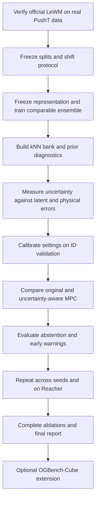

# Implementation plan for uncertainty evaluation in SIGReg JEPA world models

Updated on 18 November 2026.

## 1. Research objective

Build and evaluate uncertainty estimators that identify unreliable predictions in a SIGReg-regularized JEPA world model, especially when visual observations differ from the training distribution.

Use LeWorldModel (LeWM) as the world model. Compare predictor ensemble disagreement, latent nearest-neighbor distance, and deviation from the latent Gaussian prior. Establish whether these signals predict error, detect distribution shifts, improve planning, and support abstention or early warnings.

The source of the research scope is *Evaluating Uncertainty in SIGReg-Regularized JEPA World Models*, supplied as `JEPA_Uncertainty_Report1_Final.pdf`. Sections III–VI define the tasks, methodology, implementation details, and metrics. The report is a proposal and contains expected hypotheses rather than measured project results.

This plan records the revised priority agreed in the discussion on 18 November 2026. PushT and Reacher form the core study. OGBench-Cube is optional in the PDF and follows completion of the core results.

## 2. Research questions and required evidence

| ID | Hypothesis from the PDF | Evidence needed |
| --- | --- | --- |
| H1 | Shared-encoder ensemble disagreement is more informative under action shift than visual shift | Compare disagreement–error correlation and detection performance under separately controlled action and visual shifts |
| H2 | Encoder-side measures can detect visual shift more effectively | Evaluate kNN and prior deviation on observed encoder representations and compare them with disagreement on matched observations |
| H3 | A useful uncertainty estimate improves planning under shift | Compare original latent MPC and uncertainty-penalized MPC on identical start–goal cases |
| H4 | An ID-calibrated threshold identifies likely failures early enough for abstention | Measure risk–coverage, success at 80% coverage, detection lead time, missed failures, and false alarms |

The report specifies five predictors initially, kNN with k = 10, three severity levels per shift family, 3–5 seeds, and 95% confidence intervals. It does not specify a target AUROC, correlation, or minimum success-rate improvement. The cited 96% PushT success figure is a baseline literature result.

A finding that an estimator fails under shift can answer the research question if the evaluation is valid and reproducible. Experiments should preserve negative results.

## 3. Scope and priority

### Required core work

- Verify the official LeWM baseline on real PushT data.
- Prepare episode-disjoint training, validation, ID-test, and shifted-test partitions.
- Implement a comparable five-member predictor ensemble with a frozen shared representation.
- Build a training-only latent kNN reference bank.
- Implement prior deviation and check the Gaussian assumption, with empirical Mahalanobis fallback when appropriate.
- Measure uncertainty against latent and physical-state prediction errors.
- Evaluate controlled action and visual shifts at three severities.
- Compare uncertainty-aware planning with the original planner.
- Evaluate initial abstention and warnings during execution.
- Repeat the settled experiment on Reacher and across independent seeds.
- Run the ensemble-size and kNN-neighbor ablations.
- Produce the final tables, plots, and conclusions for H1–H4.

### Optional extension

Extend the completed protocol to OGBench-Cube. Schedule this after the PushT and Reacher results, ablations, and analysis are complete.

### Implementation focus

The uncertainty evaluator combines estimation code, calibration artifacts, and experimental analysis around LeWM. The proposed methods do not require an additional neural classifier that fuses the three scores. Keep each estimator separately measurable.

## 4. Current implementation and course corrections

The repository contains baseline runners, dataset and checkpoint manifests, uncertainty scores, ensemble fitting, offline analysis, action holdout, planning traces, and reporting commands. Local simulator fixtures exercised these paths on CPU and CUDA. The verification record reports 18 passing tests. Published-dataset reproduction and the research hypotheses remain unverified.

| Issue identified in the current workflow | Correction before the main study |
| --- | --- |
| Repeated small smoke runs consumed time before real-data results | Use smoke checks to resolve execution failures, then prioritize the first substantive PushT result |
| All three environments received equal priority | Finish PushT, validate on Reacher, then consider Cube |
| Reproduction expanded into a large preliminary task | Verify official checkpoints and evaluation settings, and train fresh models where controlled action support requires it |
| kNN and prior scores primarily used predicted future latents | Add observed-latent scoring for H2 and retain predicted-latent scoring for planning |
| The original trained predictor is grouped with four newly initialized predictors | Give all five members comparable training and data support before interpreting disagreement |
| New ensemble members inherit a frozen action encoder | Define the action-conditioning boundary and train its components consistently across members |
| Failure is represented by the goal deadline | Label timeout lead time explicitly and use task-specific physical failure events where available |
| Abstention is calculated retrospectively | Retain risk–coverage analysis and add a real initial accept/reject execution path |
| Diagnostic thresholds and probe choices were added during implementation | Record these as experimental decisions and fix them before inspecting shifted-test outcomes |

The baseline implementation can remain useful while the uncertainty path is corrected. The next research milestone is a real-data PushT uncertainty table with observed and predicted scores distinguished and physical prediction errors included.

## 5. Overall workflow

## 6. Phase 1 — Freeze the experimental specification

### Actions

1. Identify the exact dataset version, checkpoint, preprocessing, environment version, and code revision.
2. Partition complete episodes into training, validation, and ID-test data.
3. Generate shifted tests from the designated test partition.
4. Define the supported action range in each environment’s actual action convention.
5. Define three severities for each shift family.
6. Define one-step and rollout prediction horizons.
7. Specify physical probe targets and units.
8. Specify task success, failure, episode budget, and warning timestamps.
9. Specify normalization, hyperparameter selection, and threshold calibration rules.
10. Record training seeds and evaluation case sampling seeds separately.

Fit reference banks, probe parameters, and empirical latent distributions using training data. Use ID validation for score scales, penalty weights, and abstention thresholds. Preserve ID-test and shifted-test results for final evaluation.

### Deliverables

- A versioned experiment configuration.
- Episode split manifests.
- Shift definitions and severity parameters.
- A metric definition sheet.

### Completion evidence

- Every episode has one declared partition.
- Reference and calibration data sources are traceable.
- A result can be recreated from its code, model, dataset, split, and configuration identifiers.

## 7. Phase 2 — Establish the real PushT baseline

### Actions

1. Download and inspect the official PushT dataset.
2. Verify its schema, action semantics, episode boundaries, and image preprocessing.
3. Load the official LeWM checkpoint.
4. Run evaluation using the matching CEM/MPC protocol.
5. Save per-episode outcomes and the exact start–goal pairs.
6. Measure latent prediction error and planning runtime.
7. Investigate material deviations through preprocessing, normalization, simulator behavior, checkpoint loading, and planner settings.

The PDF explicitly starts with official code and checkpoints. Verification of that baseline is sufficient to start the uncertainty comparison. Fresh end-to-end training is required for the restricted-action model so that its representation and dynamics have the intended training support.

### Deliverables

- Real-data baseline success rate and per-case outcomes.
- Checkpoint and environment provenance.
- A short explanation of any remaining reproduction discrepancy.

### Completion evidence

The model demonstrates useful ID prediction and planning behavior under the declared protocol. Exact agreement with a single published percentage is assessed in the context of case sampling and run variation.

## 8. Phase 3 — Build controlled shifts

### 8.1 Visual shift

1. Choose held-out physical states and action sequences.
2. Produce clean and perturbed observations for the same states.
3. Apply three predetermined appearance severities.
4. Preserve state, dynamics, actions, and goal reachability.
5. Record whether the perturbation affects the current observations, goal observations, or both.
6. Use the same perturbation rule for training-free evaluation across seeds.

The PDF permits colors or distractors. The proposed initial implementation uses one controlled color-change family to complete the central comparison quickly. Add another visual family after the first result is understood.

Image transformations should preserve object visibility sufficiently to represent the intended visual shift. Record any severity that introduces occlusion or removes task information.

### 8.2 Action shift

1. Define the supported action range using the environment’s action convention.
2. Train the base encoder and dynamics on permitted transitions only.
3. Keep episode-disjoint ID validation and test sets.
4. Evaluate actions outside the supported range at three severities.
5. Maintain clean visual rendering rules.
6. Save commanded actions and actions actually applied after simulator clipping.

Use matched starting states for supported versus unsupported one-step actions where the simulator permits state restoration. Higher-action recorded trajectories can introduce state-distribution differences and should be identified as such in the analysis.

### Deliverables and completion evidence

Save clean/shifted case pairs, severity labels, and action-support evidence. Demonstrate that visual perturbations preserve the underlying physical trajectories and that held-out action tests use actions excluded from training.

## 9. Phase 4 — Implement the estimators consistently

### 9.1 Representation boundary

Identify the complete pathway producing the target latent used by the prediction loss and SIGReg. Record whether this includes a projection head. Freeze that pathway for the ensemble experiment.

Keep the latent definition consistent across target prediction, kNN references, distribution fitting, and probes. If a different latent is useful for an analysis, name it explicitly and report that comparison separately.

### 9.2 Predictor ensemble

Start with N = 5 as specified in the PDF.

- Initialize each member’s trainable components independently.
- Use the same architecture, training support, stopping rule, and training budget.
- Bootstrap complete training trajectories for diversity.
- Decide which action-encoding and prediction-projection components belong to each member.
- Train those components consistently.
- Compare member ID prediction losses before interpreting disagreement.

For member predictions ź_i and their mean ź_mean, use a declared variance aggregation such as mean squared distance from the ensemble mean across latent dimensions. Save both the member predictions and the resulting scalar score.

Measure disagreement for the same next-step input first. Evaluate divergence between member rollouts as a separate horizon-dependent quantity.

### 9.3 Latent kNN

- Build the reference bank from training observations only.
- Start with k = 10.
- Define the distance and neighbor aggregation explicitly.
- Score observed latents to detect unfamiliar observations.
- Score predicted future latents separately for planning.
- Record bank size and sampling strategy.
- Check stability under a practical reference-bank size change before fixing the bank.

### 9.4 Prior deviation and fallback

- Check the empirical latent distribution on ID data.
- Implement deviation of squared latent norm from its expected chi-square distribution.
- Inspect numerical saturation and the information retained by the scalar score.
- Apply training-fitted empirical Mahalanobis distance when the Gaussian assumption is poor.
- Select the fallback using ID information only.
- Record the chosen mode and diagnostic thresholds.

The PDF specifies checking the Gaussian assumption and using the fallback. The exact test statistic, thresholds, covariance regularization, and tail score remain implementation choices that must be documented.

### Deliverables

- Five comparable predictor checkpoints.
- A training latent bank.
- Prior diagnostics and distribution artifacts.
- Explicit interfaces for observed-input scores and rollout scores.

### Completion evidence

Each estimator is reproducible, has the intended data source, and returns finite scores. ID loss checks establish that ensemble disagreement is not dominated by severely undertrained members.

## 10. Phase 5 — Build error labels and physical probes

### Latent error

Measure the norm between the predicted next latent and the encoded next observation. Record whether a result uses a norm, squared norm, or mean squared error. Use one declared convention in each comparison.

### Physical-state error

Fit a linear probe on ID training latents and simulator states.

| Environment | Initial physical quantities |
| --- | --- |
| PushT | Block position, block orientation, and agent position |
| Reacher | Arm joint configuration and/or end-effector position |
| OGBench-Cube, optional | Cube position and relevant manipulation state |

For orientation, specify angular wrapping or a sine/cosine representation. Report units and any training-fitted standardization.

Evaluate the probe on both observed latents and predicted latents. Report observed-latent probe error alongside physical prediction error to show when the probe itself becomes unreliable under visual shift.

### Prediction record

Each record should identify the task, seed, episode, step, condition, severity, action, prediction horizon, estimator score, latent error, and physical error. Retain member predictions or sufficient artifacts to inspect disagreements.

### Completion evidence

The probe works adequately on held-out clean data, and uncertainty can be aligned with a measurable error at the same prediction horizon.

## 11. Phase 6 — Produce the first substantive uncertainty result

Run the complete offline comparison on PushT before expanding the planning study.

| Condition | Ensemble | Observed-latent kNN | Observed-latent prior/fallback |
| --- | --- | --- | --- |
| ID | Error ranking | Error ranking | Error ranking |
| Action shift, severity 1–3 | Correlation and shift detection | Correlation and shift detection | Correlation and shift detection |
| Visual shift, severity 1–3 | Correlation and shift detection | Correlation and shift detection | Correlation and shift detection |

Repeat the relevant scoring analysis on predicted future latents and label it accordingly.

### Metrics

- Spearman correlation between uncertainty and latent error.
- Spearman correlation between uncertainty and physical-state error.
- AUROC distinguishing clean and shifted examples.
- Score distributions by condition and severity.
- Error distributions by condition and severity.

Calculate error correlation within each condition as well as any pooled analysis. A pooled correlation can be driven by differences between groups rather than useful rankings within them.

Shift detection and failure prediction answer different questions. Include task failure labels in the downstream analysis and avoid treating shift AUROC alone as proof of failure awareness.

### Deliverables

- A real-data uncertainty comparison table.
- Uncertainty-versus-error plots.
- Examples of low-disagreement/high-error visual failures.
- An initial interpretation of H1 and H2.

### Completion evidence

The results show what each method detects, where it is overconfident, and whether the observations support the proposed hypotheses.

## 12. Phase 7 — Calibrate using ID validation data

1. Fit score normalization from ID validation scores.
2. Define the planning penalty grid before inspecting shifted-test results.
3. Evaluate candidate penalty weights on matched ID validation cases.
4. Choose the penalty using the stated selection rule.
5. Fit an abstention threshold from ID validation plan scores.
6. Freeze these choices for all declared test conditions.

Permit the selected planning weight to be zero. Record undefined metrics and constant score distributions explicitly.

If the same validation partition serves both model selection and threshold calibration, record that reuse. Use separate ID subsets when needed to reduce selection effects and sufficient data are available.

### Completion evidence

Every test configuration has a saved ID calibration artifact and selection record. Shifted-test outcomes do not influence these choices.

## 13. Phase 8 — Compare planning performance

The baseline planner minimizes terminal latent distance to the encoded goal. The uncertainty-aware planner adds a weighted sum of uncertainty along the predicted trajectory.

For each paired comparison, use identical start–goal cases, action constraints, solver settings, evaluation seeds, and execution budgets.

Evaluate each estimator independently. Fix how ensemble predictions produce the planning goal cost so estimator comparisons do not silently change the underlying planning model.

### Metrics

- Task success rate for ID and each shift severity.
- Paired success-rate difference.
- Failures recovered and successes lost.
- Planning runtime.
- Raw and applied action exposure beyond training support.

An input-unfamiliarity score can identify a visually shifted scene while providing little differentiation among candidate action sequences. Measure candidate score variation and inspect examples to interpret planning results.

### Completion evidence

Matched results establish whether the penalty helps, harms, or has no measurable effect under each condition. Report this outcome even when it contradicts H3.

## 14. Phase 9 — Abstention and early warnings

### Initial abstention

1. Plan from the initial observation.
2. Score the final plan returned by CEM.
3. Use its maximum predicted uncertainty as the episode acceptance score.
4. Apply the threshold fitted on ID validation data.
5. Execute accepted episodes and record declined episodes.

Retrospective evaluation using complete attempted trajectories can support risk–coverage analysis. Verify the actual initial accept/reject branch as well.

### Metrics

- Coverage, the fraction of offered episodes attempted.
- Risk, the failure fraction among attempted episodes.
- Area under the risk–coverage curve.
- Success at 80% coverage, with the achieved coverage disclosed when tied scores prevent exactly 80%.
- Successful completions divided by all offered episodes.

### Warnings during execution

Score the returned plan at every replan and save its simulator-step timestamp. Define failure events before evaluation.

- For goal timeout, measure warning time relative to the deadline and label it timeout lead time.
- For an observable physical failure, use that event’s actual timestamp.
- Where a task lacks a meaningful earlier failure event, disclose that limitation.

Report lead time together with detected-failure fraction, missed failures, and ID false-alarm rate. Specify the false-alarm denominator and whether the metric is per step or per episode. Long lead time alone does not establish reliable warnings.

### Completion evidence

The selected score supports a reproducible accept/reject decision and the warning metrics use a declared failure event and time unit.

## 15. Phase 10 — Reacher, seeds, and ablations

Repeat the settled experiment on Reacher using its physical quantities and action semantics.

Start with three independent seeds, within the report’s 3–5 seed range. Expand to five when observed run variation makes conclusions unstable and compute permits it.

Distinguish independent base-model training seeds, ensemble-fitting seeds, and evaluation sampling seeds. Confidence intervals must use the relevant independent run as the replication unit. Repeated evaluation of one checkpoint does not measure independent model-training variation.

### Required ablations

| Factor | PDF starting value | Proposed compact comparison |
| --- | --- | --- |
| Ensemble size | N = 5 | N = 3 and 5 |
| kNN neighbors | k = 10 | k = 5, 10, and 20 |

The comparison values are implementation proposals. Fix them before the final ablation runs. Hold other settings constant and preserve the same test cases.

### Completion evidence

The results include both core environments, independent-run variation, and evidence of sensitivity to the requested estimator parameters.

## 16. Phase 11 — Final analysis and submission

Prepare the following outputs.

1. Baseline verification table with reported and reproduced settings and results.
2. Dataset partition counts and shift definitions.
3. Estimator-quality tables for ID, action shift, and visual shift.
4. Uncertainty-versus-error and score-distribution plots.
5. Planning success by shift severity.
6. Risk–coverage curves and success at the declared coverage.
7. Lead time, missed failures, and false alarms.
8. Ensemble-size and kNN-neighbor ablations.
9. Qualitative confident-failure examples.
10. A conclusion for each of H1–H4, supported or unsupported as measured.
11. Reproduction commands, versions, checkpoint identifiers, and configuration artifacts.

The report should distinguish observations about the shared encoder, dynamics predictors, and planning behavior. Explain limitations in the probes, severity definitions, and available failure events.

## 17. Repository work map

The current scripts provide a starting point for the corrected workflow. Their presence does not establish completion of the experiments.

| Component | Current file | Planned use or correction |
| --- | --- | --- |
| Baseline runner | `reproduction/run.py` | Execute declared benchmark and uncertainty planning configurations |
| Upstream adaptation | `reproduction/prepare_source.py` | Keep changes explicit and verify reproducibility |
| Artifact fitting | `reproduction/fit_uncertainty.py` | Correct ensemble comparability and record the representation boundary |
| Scoring | `reproduction/uncertainty.py` | Separate observed-input scoring from rollout scoring |
| Action support | `reproduction/action_holdout.py` | Validate action semantics, split integrity, and actual support exclusion |
| Offline evaluation | `reproduction/evaluate_uncertainty.py` | Produce the central real-data comparison with physical probes |
| Plan instrumentation | `reproduction/plan_trace.py` | Record the selected plan and action exposure |
| Episode analysis | `reproduction/report_episode_metrics.py` | Clarify timeout warnings and implement actual abstention |
| Penalty selection | `reproduction/select_penalty.py` | Select settings using ID validation only |
| Baseline report | `reproduction/benchmark_report.py` | Compare full benchmark results with the declared published protocol |
| Paired planning | `reproduction/compare_planning.py` | Compare matched cases across penalty settings |
| Offline summary | `reproduction/summarize_uncertainty.py` | Aggregate independent runs with transparent counts |
| Smoke workflow | `reproduction/smoke_experiment.py` | Use for integration failures and setup verification |

Commit and push verified project changes. Continue using date-only commit messages in Asia/Dubai. Preserve the source report’s scope when interpreting older repository instructions that treated Cube as required.

## 18. Fast execution order

| Priority | Work | Exit result |
| --- | --- | --- |
| 1 | Freeze protocol and correct estimator inputs and ensemble training | Faithful implementation ready for real data |
| 2 | Verify the real PushT baseline | Credible ID model behavior and saved provenance |
| 3 | Run offline uncertainty comparison on PushT | First substantive table for H1 and H2 |
| 4 | Run planning, abstention, and warning comparisons | Evidence for H3 and H4 |
| 5 | Repeat across three seeds and on Reacher | Reproducible core study |
| 6 | Complete ablations, figures, and writing | Submission-ready project |
| 7 | Extend to Cube if time and compute remain | Optional cross-task extension |

Schedule by these dependencies and measured run times. A reliable calendar estimate requires the target GPU, dataset transfer speed, and an initial real-data timing run. Cache frozen-encoder latents for repeated offline predictor and estimator analysis where the transformations and data access rules permit it. Re-encode shifted images when evaluating appearance changes.

Stop repeating successful smoke checks unless a code change or a newly identified concern affects them. Prioritize the actual PushT uncertainty experiment after correcting the identified methodology issues.

## 19. Completion checklist

- [ ] Experimental protocol and independent episode splits are fixed.
- [ ] Official LeWM baseline is verified on real PushT data.
- [ ] Encoder and target latent definition are documented.
- [ ] Five predictors receive comparable training.
- [ ] Observed-latent and rollout uncertainty are evaluated explicitly.
- [ ] kNN references and empirical distributions use training data only.
- [ ] Gaussian diagnostics and fallback decisions use ID information only.
- [ ] Physical probes are validated and their own errors are disclosed.
- [ ] Action and visual shift families have three reproducible severities.
- [ ] Held-out actions were excluded from base-model training.
- [ ] Real-data uncertainty metrics address H1 and H2.
- [ ] Planning comparisons use matched cases and ID-selected settings.
- [ ] Initial abstention and warning behavior are evaluated.
- [ ] Failure events, false-alarm denominators, and timestamps are defined.
- [ ] Core results cover PushT and Reacher.
- [ ] Three to five independent runs and 95% intervals are reported appropriately.
- [ ] Ensemble-size and kNN-neighbor ablations are complete.
- [ ] Final figures and conclusions address H1–H4, including negative results.
- [ ] Code, configurations, versions, and run provenance are available in the repository.
- [ ] OGBench-Cube extension is completed if included in the final submission.

## 20. Immediate next milestone

Produce a real-data PushT table comparing all three estimators under ID, controlled action shift, and controlled visual shift. Include observed and predicted latent scores, physical prediction error, uncertainty–error correlation, and shift AUROC.

This milestone supplies the first direct answer to the proposal’s central question and determines which signals merit the larger planning study.
